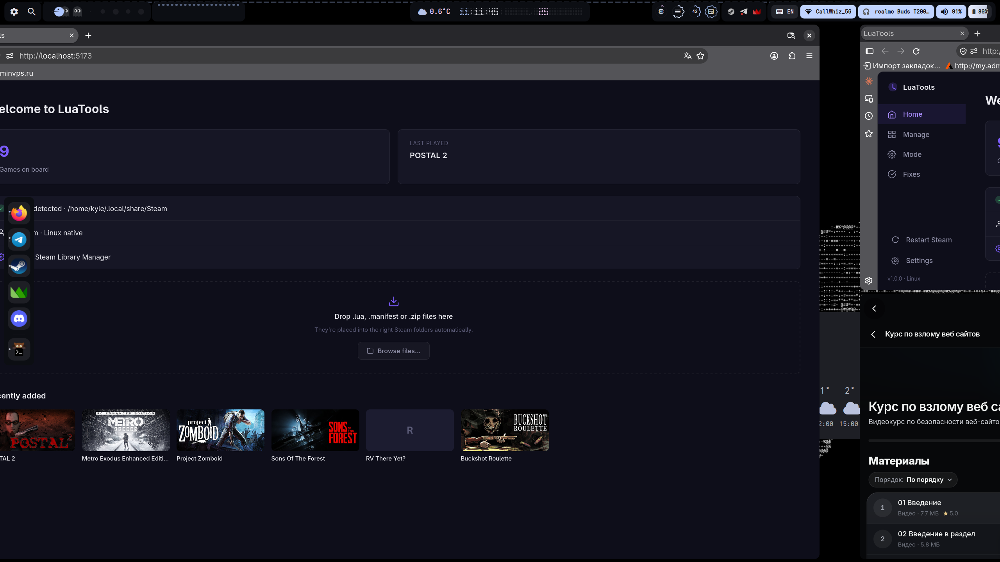

# LuaTools Linux

Native Linux alternative to [LuaTools](https://lua.tools) — a Steam library manager with game details, manifest viewer, and quick actions.



## Install

```bash
curl -fsSL https://raw.githubusercontent.com/kyle-scofield/luatools-linux/main/install.sh | sh
```

Then run `luatools` — opens as a desktop app.

## Features

- Steam library auto-detection
- Game details from Steam Store API (cached 7 days)
- Launch games, open install folders
- Manifest viewer, file browser
- Proton version listing
- Drop zone for .lua / .manifest / .zip files
- Desktop app (Chromium app mode / Firefox)
- `.desktop` entry for app menu

## Stack

- **Backend**: Node.js + Express
- **Frontend**: React 19 + Vite 6 + Tailwind CSS 4 + Framer Motion
- **Data**: Steam appmanifest ACF parsing, Steam Store API

## Dev

```bash
git clone https://github.com/kyle-scofield/luatools-linux.git
cd luatools-linux
npm install && cd webapp && npm install && cd ..
npm run dev
```

## Requirements

- Node.js 18+
- Steam installed (auto-detected at `~/.local/share/Steam`)

## License

MIT
